# leo-propagator

A learning project for building and understanding satellite orbit propagation
in Python, with an independent comparison against Orekit. The implementation is
kept small so that the physical model, numerical integration and verification
can be read and explained directly.

**Milestone 1 remains the default:** a satellite initially in a circular orbit
400,000 m above a spherical Earth, subject only to Earth's central gravity.
All calculations, saved values and plot axes use SI units; angles use radians.

**Milestone 2 adds optional J2 gravity:** a seven-day comparison of two-body
and J2 motion from the same 400,000 m, 51.6-degree initial Cartesian state.
The original tests and example outputs are preserved. J2 results are saved
separately under `outputs/j2/`.

**Milestone 3 adds optional atmospheric drag:** configurable mass, drag
coefficient and constant effective area, an illustrative exponential density
profile, a co-rotating atmosphere and a lower-altitude stopping event. A
seven-day density-sensitivity study compares J2-only with density factors
0.5, 1 and 2. Results are separate under `outputs/drag/`. This is a learning
experiment, not a validated space-weather forecast.

**Milestone 4 adds optional Orekit comparison:** explicitly matched GCRF/TAI
initial conditions, central/J2 gravity and spherical exponential drag, force
checks before integration, and independent tolerance studies. Results are
saved under `outputs/orekit/`. Milestones 1–3 still run without Java or Orekit.

## Implemented capabilities

- Integrate all six Cartesian position and velocity components for 86,400 s
  in a clearly defined Earth-centred inertial frame using `solve_ivp` and DOP853.
- Calculate the circular speed, analytical orbital period and exact trajectory.
- Compare numerical position and velocity with the analytical solution at
  matching times, and quantify altitude, specific energy and angular momentum errors.
- Check convergence by repeating the propagation with tighter tolerances.
- Save orbit, altitude and validation figures, plus a JSON report, and run four
  original milestone 1 physics and numerical verification tests.
- Enable an axisymmetric J2 acceleration and verify the matching total energy
  and axial angular momentum; compare secular nodal regression with theory.
- Extract osculating elements with explicit undefined-angle handling, and run
  13 additional tests for J2, orbital geometry and seven-day convergence.
- Compare drag-induced decay, density and acceleration histories, and position
  differences in the J2-only RTN frame; verify drag work against energy change
  and convergence for every density case, with 17 additional tests.
- Compare with Orekit's own force models and Hipparchus integrator, verify
  frame/atmosphere matching, and run 11 optional Orekit tests.

## Setup and run

Run the commands from the repository root. Use Python 3.9 through 3.12 with
the versions pinned in `requirements.txt`. Local environments are ignored by
Git; the environment definitions remain in the repository.

To create an environment with Conda (Python 3.9, matching the validation run's
Python version family):

```powershell
conda env create --prefix ./.conda --file environment.yml
conda activate ./.conda
python orbit.py
python j2.py --days 7
python drag.py --days 7
python -m unittest -v
python -m pip check
```

Alternatively, on Windows with Python 3.12 installed:

```powershell
py -3.12 -m venv .venv
.\.venv\Scripts\python.exe -m pip install -r requirements.txt
.\.venv\Scripts\python.exe orbit.py
.\.venv\Scripts\python.exe j2.py --days 7
.\.venv\Scripts\python.exe drag.py --days 7
.\.venv\Scripts\python.exe -m unittest -v
.\.venv\Scripts\python.exe -m pip check
```

On Linux/macOS with Python 3.12 installed:

```bash
python3.12 -m venv .venv
.venv/bin/python -m pip install -r requirements.txt
.venv/bin/python orbit.py
.venv/bin/python j2.py --days 7
.venv/bin/python drag.py --days 7
.venv/bin/python -m unittest -v
.venv/bin/python -m pip check
```

If the project's `.conda` environment already exists, activate it instead of
creating it again. For a direct invocation in PowerShell without Conda activation:

```powershell
# Supply the DLL paths normally set by conda activation.
$env:PATH = "$PWD\.conda;$PWD\.conda\Library\bin;$PWD\.conda\Scripts;$env:PATH"
.\.conda\python.exe -m pip install -r requirements.txt
.\.conda\python.exe orbit.py
.\.conda\python.exe j2.py --days 7
.\.conda\python.exe drag.py --days 7
.\.conda\python.exe -m unittest -v
```

All three scripts save figures without opening windows. Add `--show` for plot
windows or `--output-dir path` to select the output directory. `orbit.py`
runs the original 24-hour equatorial two-body example. `j2.py` and `drag.py`
default to seven days; `--days` selects another positive duration. Each example
performs its own tolerance comparison. Use `python -m unittest -v test` to run only
the four original tests, or `python -m unittest -v` for the full suite. In the
base environment, 34 tests pass and 11 optional Orekit tests are skipped.
In the separate Orekit environment described below, all 45 tests run and pass.

## Files and outputs

- `orbit.py`: shared constants, central/J2 gravity, initial state and solver
  with optional drag work and altitude termination,
  plus the original milestone 1 reference, diagnostics and plotting.
- `j2.py`: inclined comparison, correct J2 invariants, secular RAAN analysis
  and plots, including three integration tolerance levels.
- `elements.py`: instantaneous Keplerian elements and undefined-angle masks.
- `test.py`: four original physics and full-day checks, unchanged.
- `test_j2.py`: 13 J2, element geometry and seven-day verification checks.
- `atmosphere.py`: configurable spacecraft properties, illustrative density
  and co-rotating drag acceleration.
- `drag.py`: density experiments, nodal-period averaging, RTN differences,
  work-energy diagnostics, convergence and plots.
- `test_drag.py`: 17 drag, guard, averaging, geometry and seven-day checks.
- `orekit_backend.py`: optional wrapper/JVM setup, uniform rotating frame,
  built-in Orekit gravity/atmosphere/drag and numerical Cartesian propagation.
- `orekit_compare.py`: smoke/force checks, ordered comparisons, independently
  tightened solvers, checkpoint reports and figures.
- `test_orekit.py`: 11 optional model, geometry, stopping and trajectory checks.
- `requirements-orekit.txt`: pinned packages for the isolated comparison environment.
- `requirements.txt`: NumPy, SciPy and Matplotlib versions used for this milestone.
- `outputs/orbit_and_altitude.png`: the numerical orbit overlaid on the exact
  circle, and altitude versus elapsed time.
- `outputs/validation.png`: position, velocity, energy and angular momentum errors.
- `outputs/validation.json`: model constants, solver settings, package versions,
  maximum and final errors, and the tighter-tolerance comparison.
- `outputs/j2/comparison.png`, `outputs/j2/validation.png` and
  `outputs/j2/validation.json`: separate milestone 2 figures and numerical report.
- `outputs/drag/decay.png`, `atmosphere.png`, `rtn.png`, `validation.png` and
  `validation.json`: separate milestone 3 figures and numerical report.
- `outputs/orekit/`: five Cartesian/RTN comparison figures, a convergence
  figure and a full force/checkpoint/tolerance report in `validation.json`.


## Frame, units and assumptions

The frame is an idealised, right-handed Earth-centred inertial (ECI) frame:

- Origin: the centre of a stationary, spherical Earth.
- `+z`: a fixed reference north-pole direction.
- `+x`: an arbitrary fixed direction in the reference equatorial plane.
- `+y`: completes the right-handed system, with unit vector `z cross x`.

The axes stay fixed throughout the integration; they do not rotate with Earth.
The initial orbit lies in the `xy` plane and travels counterclockwise when
viewed from `+z`. This defines an idealised frame, not a full implementation of
GCRF, EME2000 or Earth orientation transformations. Time is elapsed seconds
from an arbitrary initial instant, so no calendar epoch or time-scale conversion
is needed for this autonomous model.

| Quantity | Adopted value | SI unit |
| --- | ---: | --- |
| Earth gravitational parameter, `mu = GM` | 3.986004418e14 | m³/s² |
| Spherical Earth radius, `R_E` | 6,371,000 | m |
| Initial altitude, `h_0` | 400,000 | m |
| Initial orbital radius, `r_0 = R_E + h_0` | 6,771,000 | m |
| Propagation duration | 86,400 | s |

The radius is the volumetric mean radius listed in
[NASA's Earth fact sheet](https://nssdc.gsfc.nasa.gov/planetary/factsheet/earthfact.html).
`mu` is an adopted model parameter, used identically in the force law and reference
solution. Altitude means `norm(position) - R_E`; it is not ellipsoidal/geodetic
altitude. The satellite is a test particle: its mass cancels from the equations.
Milestone 1 uses only Earth's central gravity. Milestone 2 adds the J2 gravity
term, with the symmetry axis fixed along inertial `z`, while keeping spherical
altitude as the reporting convention. Both modes omit atmosphere and drag,
other bodies, radiation pressure, relativity and manoeuvres. Higher gravity
harmonics, time-varying coefficients and pole motion are not included.

## Equations and initial conditions

Define the state as

$$
\mathbf y = [x,y,z,v_x,v_y,v_z]^T.
$$

Newton's law for a central gravitational field gives

$$
\frac{d\mathbf r}{dt}=\mathbf v,\qquad
\frac{d\mathbf v}{dt}=-\frac{\mu}{\|\mathbf r\|^3}\mathbf r.
$$

The vector acceleration points inward. Its magnitude is `mu / r²`: the third
power in the vector expression includes the extra factor needed to turn the
position vector into a unit vector. `two_body_rhs` returns these six derivatives,
not the next state. Its `t` argument is unused because this force law has no
explicit dependence on time.

### Why is that the initial velocity?

For a circle, the required inward acceleration is `v²/r_0`. Equating this to
`mu/r_0²` yields

$$
v_c=\sqrt{\frac{\mu}{r_0}}=7672.598648385\ \mathrm{m/s}.
$$

The velocity must also be tangent to the circle. Starting on the positive
`x` axis, choose motion along positive `y`:

$$
\mathbf r(0)=(6771000,0,0)\ \mathrm m,\qquad
\mathbf v(0)=(0,7672.598648385,0)\ \mathrm{m/s}.
$$

Tangency alone does not make an orbit circular; the speed must have this value
as well. The inertial orbital velocity is used directly: no Earth-rotation speed
is added. With central gravity and both `z` and `v_z` initially zero, the orbit
remains in this plane, although the code integrates all three spatial dimensions.

### How does the integrator advance the orbit?

`solve_ivp` calls `two_body_rhs` at trial states. DOP853 is an explicit
eighth-order Runge–Kutta method: each step combines derivative estimates from
several intermediate states to advance position and velocity together. In
general Runge–Kutta notation, with step length `dt`,

$$
\mathbf k_i=f\left(t+c_i\,dt,
  \mathbf y+dt\sum_{j<i}a_{ij}\mathbf k_j\right),\qquad
\mathbf y_{\rm next}=\mathbf y+dt\sum_i b_i\mathbf k_i.
$$

The method's coefficients specify its trial stages and weights. An error
estimate controls whether a step is accepted and how large the next step is.
It is scaled using `atol_i + rtol * abs(y_i)` for each state component. See the
[SciPy solver documentation](https://docs.scipy.org/doc/scipy-1.13.1/reference/generated/scipy.integrate.solve_ivp.html).

The nominal run uses `rtol = 1e-10`, position `atol = 1e-4 m`, and velocity
`atol = 1e-7 m/s`. Relative tolerance is dimensionless; each absolute tolerance
has the units of its own component. These control estimated local error, and
do not guarantee a particular final position error after a full day.

`t_eval` requests saved states every 10 s, including both endpoints. It does
not impose 10 s integration steps. The solver adapts its internal steps and
interpolates to the requested times. The report's RHS evaluation count measures
derivative calls, including trial stages and interpolation work; it is not a
step count. The script checks successful completion before using the result.

### What evidence shows the result is correct?

The angular rate and period follow from the circular speed:

$$
n=\sqrt{\frac{\mu}{r_0^3}},\qquad
T=\frac{2\pi}{n}=5544.855095981\ \mathrm s.
$$

The satellite completes about 15.582012245 revolutions in 86,400 s. A full day
is not an integer number of periods, so the final point should not coincide
with the initial point.

The exact trajectory at each output time is

$$
\mathbf r_{\rm exact}(t)=r_0(\cos nt,\sin nt,0),\qquad
\mathbf v_{\rm exact}(t)=v_c(-\sin nt,\cos nt,0).
$$

The script compares full position and velocity vectors at matching times:
`norm(r_num - r_exact)` and `norm(v_num - v_exact)`. This detects radial,
orbital-plane and phase errors; matching the shape of a circle alone would
not test whether the satellite moves around it at the correct rate.

Two independent physical invariants are also checked:

$$
\epsilon=\tfrac12\|\mathbf v\|^2-\frac{\mu}{\|\mathbf r\|},\qquad
\mathbf h=\mathbf r\times\mathbf v.
$$

Their exact values for this initial condition are

$$
\epsilon_0=-\frac{\mu}{2r_0}=-29434385.009599764\ \mathrm{m^2/s^2},
\qquad
\mathbf h_0=(0,0,51951165448.21493)\ \mathrm{m^2/s}.
$$

Energy is constant because gravity is conservative; angular momentum is constant
because a central force has zero torque, `r cross a = 0`. Diagnostics use the
exact invariant values as references, which agree with the initial numerical
values to floating-point precision. Relative energy error is
`(epsilon - epsilon_0) / abs(epsilon_0)`; relative angular momentum error is
`norm(h - h_0) / norm(h_0)`. The latter compares the whole vector, so it can
detect an incorrect orbital-plane direction as well as a magnitude change.
The reported maxima take absolute values; final altitude and energy errors
retain their signs.

DOP853 does not enforce these invariants exactly. Small conservation errors,
small time-matched trajectory errors and improvement when tolerances tighten
together validate this implementation within the stated model.

## Measured validation results

Run with Python 3.9.13, NumPy 2.0.2, SciPy 1.13.1 and Matplotlib 3.9.4.
The solver reached 86,400 s successfully and returned 8,641 saved states, using
6,191 RHS evaluations. These maxima are measured on the 10 s output grid,
including interpolated states; they are not rigorous bounds between samples.

| Error quantity | Maximum absolute value | Final value at 86,400 s |
| --- | ---: | ---: |
| Altitude error [m] | 1.420762e-3 | -2.268264e-4 |
| Position error norm [m] | 7.625973e-3 | 6.848396e-3 |
| Velocity error norm [m/s] | 8.388148e-6 | 7.838255e-6 |
| Specific energy error [m²/s²] | 8.693080e-3 | -2.459142e-3 |
| Relative specific energy error | 2.953376e-10 | -8.354659e-11 |
| Specific angular momentum vector error norm [m²/s] | 7.671570 | 2.170174 |
| Relative specific angular momentum vector error | 1.476689e-10 | 4.177334e-11 |

Reducing every tolerance by a factor of 100 gives `rtol = 1e-12`, position
`atol = 1e-6 m`, and velocity `atol = 1e-9 m/s`. That run uses 10,991 RHS
evaluations. Its maximum position error is **1.199673e-4 m**, an improvement
of **63.57 times**. Its maximum velocity error is 1.335773e-7 m/s, relative
energy error is 3.111666e-12, and relative angular momentum error is
1.555950e-12. The dynamics, initial state and saved times are identical in both
runs. Error reduction supports convergence; adaptive local tolerances do not
imply an identical reduction factor in accumulated trajectory error.

The orbit curves overlap at the figure's scale. The altitude panel uses a
400,000 +/- 1 m range, so the small altitude error is shown in its annotation.
The validation figure makes the trajectory and conservation errors visible.
Errors can oscillate because both integration and output interpolation
contribute; they need not grow monotonically with time.

All **4 original milestone 1 tests pass**. The trajectory checks require
maximum position error below 0.1 m, velocity error below 1e-4 m/s and altitude
error below 0.01 m.
Both relative conservation errors must stay below 1e-8, and the tighter run
must reduce both position and velocity errors by more than a factor of 10.
The initial-state check verifies tangency, inward gravity and the centripetal
acceleration condition; the trajectory check also verifies the full duration
and preservation of `z = v_z = 0`. `pip check` reports no broken requirements.

Full-precision values are saved in `outputs/validation.json`. Small differences
in the last digits may occur across platforms. These are numerical errors
relative to the specified ideal model.

## Numerical verification and prediction accuracy

The errors above measure agreement with the exact solution of the same
idealised two-body model. The trajectory comparisons, conservation checks and
tolerance experiment verify the implementation and its numerical accuracy
for this case. The analytical reference uses the same adopted Earth constants,
so these checks do not establish their suitability for a particular real satellite.

Real-world orbit-prediction accuracy also depends on the initial-state
uncertainty, force models, atmospheric density and satellite properties, and
the physical reference frame and epoch. Earth's oblateness and atmospheric
drag matter for an actual low Earth orbit. Milestone 1 omits both; milestone 2
includes J2 but still omits drag and higher gravity harmonics.
Milestone 3 includes drag with a deliberately simple illustrative atmosphere;
it does not estimate the actual density or weather along a real orbit.
Milestone 4 compares with Orekit using these same idealised force models.
There has been no comparison with tracking observations; small numerical
errors do not establish millimetre accuracy for real satellite predictions.

## Reading and explaining the code

Follow `initial_state` → `two_body_rhs` → `propagate` first. These contain the
physical model and numerical integration. Then read `analytical_state` and
`diagnostics` to see how the result is checked. `summarize`, `plot_results` and
`main` turn those arrays into reports and figures.

For an interactive inspection:

```python
import orbit

solution = orbit.propagate()
print(solution.y.shape)  # (6, 8641): state components by saved times
print(solution.t[-1])    # 86400.0 s
position = solution.y[:3]  # metres
velocity = solution.y[3:]  # metres per second
errors = orbit.diagnostics(solution.t, solution.y)
print(orbit.summarize(errors))
```

When later comparing with Orekit, match `mu`, the inertial axes, initial
Cartesian state, elapsed times and force model. Match the spherical radius
when comparing altitudes. Using a different Earth radius changes the initial
orbital radius even if both cases are described as a 400,000 m orbit.

## Milestone 2: J2 gravitational perturbation

### Force model, potential and constants

J2 is the leading zonal term describing Earth's oblateness. The model is
axisymmetric about the fixed inertial `z` axis. Rotation about that axis does
not change this zonal potential, so no Earth-rotation transformation is needed
for this idealised model.

| Quantity | Value | Unit |
| --- | ---: | --- |
| `mu` (unchanged) | 3.986004418e14 | m³/s² |
| Positive `J2` | 1.08263e-3 | dimensionless |
| J2 reference equatorial radius `R_eq` | 6,378,137 | m |
| Spherical altitude reference `R_E` | 6,371,000 | m |
| Initial inclination | 0.9005898940290741 (51.6 degrees) | rad |
| Comparison duration | 604,800 | s |

`J2` and `R_eq` come from [NASA's Earth fact sheet](https://nssdc.gsfc.nasa.gov/planetary/factsheet/earthfact.html).
The two radii have different roles: `R_eq` sets the gravity harmonic's scale;
`R_E` defines the existing spherical altitude. The satellite still starts at
radius 6,771,000 m. A positive J2 corresponds to negative **unnormalized** C20.

Using `r = norm(position)` and `s = z/r`, the specific potential, zero at infinity, is

$$
\Phi(\mathbf r)=-\frac{\mu}{r}
\left[1-J_2\left(\frac{R_{\rm eq}}r\right)^2P_2(s)\right],
\qquad P_2(s)=\tfrac12(3s^2-1).
$$

This sign convention agrees with the Hamiltonian in
[Arnas (2022), equation (1)](https://arxiv.org/pdf/2212.08746#page=3).
Differentiating the potential gives `a = -grad(Phi)`: central gravity plus

$$
\mathbf a_{J2}=\frac{3J_2\mu R_{\rm eq}^2}{2r^5}
\begin{bmatrix}
x(5s^2-1)\\
y(5s^2-1)\\
z(5s^2-3)
\end{bmatrix}.
$$

Acceleration has units m/s² and potential has units m²/s². For positive J2,
the additional acceleration is inward on the equator and outward on the pole.
`two_body_rhs(t, state, j2=0.0)` and `propagate(..., j2=0.0)` retain pure
central gravity. Passing `j2=orbit.J2` adds the perturbation; zero skips it
exactly. `specific_potential` uses the same coefficient and reference radius.

### Shared initial conditions

At the ascending node, set initial RAAN to zero and rotate the original
circular velocity about `x` by the inclination:

$$
\mathbf r_0=(6771000,0,0)\ \mathrm m,
\qquad
\mathbf v_0=(0,4765.817619411,6012.965361426)\ \mathrm{m/s}.
$$

The speed is still `sqrt(mu/r_0)`, and velocity remains perpendicular to
position. Both simulations use **this identical Cartesian state**. It is
circular in the two-body model, and initially has zero osculating Keplerian
eccentricity in the J2 case. It is not an exact circular solution of the J2
field: periodic radius and element changes are physical responses to the
additional force. The velocity is not retuned for J2.

```python
import numpy as np
import orbit

state0 = orbit.initial_state(np.deg2rad(51.6))
central = orbit.propagate(state0=state0, duration=604800.0, j2=0.0)
perturbed = orbit.propagate(state0=state0, duration=604800.0, j2=orbit.J2)
```

### Osculating elements, RAAN and undefined angles

`elements.osculating_elements` treats each Cartesian state as an instantaneous
Keplerian orbit. It computes `h = r cross v`, node vector `N = z_hat cross h`,
eccentricity vector `e = (v cross h)/mu - r/r`, and `a` from the instantaneous
two-body energy. That energy is used to define an **osculating element**, not
as the conserved J2 energy.

RAAN is `atan2(N_y, N_x)`, measured from `+x` toward `+y` in the equatorial
plane. Returned angles are radians in `[0, 2*pi)`. The comparison applies
`np.unwrap` before fitting RAAN as `intercept + rate*time`. The free intercept
and the fit over all 10,081 output states reduce the influence of periodic
oscillations compared with a difference of two endpoints. Saving every 60 s
is sufficiently fine to avoid ambiguous RAAN jumps in this example.

| Case | Undefined angles returned as `NaN` | Useful defined angle |
| --- | --- | --- |
| Circular, inclined | Argument of periapsis, true anomaly | RAAN and argument of latitude |
| Eccentric, equatorial | RAAN, argument of periapsis, argument of latitude | True anomaly |
| Circular, equatorial | RAAN, argument of periapsis, true anomaly, argument of latitude | Geometric true longitude `atan2(y, x)` |

Circular means `e <= 1e-8`; equatorial means `sin(i) <= 1e-10`, including
the retrograde `i = pi` limit. Longitude is measured geometrically from `+x`
toward `+y`. Radial states with zero angular momentum have no orbital plane
and raise `ValueError`. RAAN fitting and the secular node prediction reject
undefined equatorial nodes explicitly. The JSON report represents undefined
initial angles as `null` rather than nonstandard JSON NaNs.

### First-order secular node prediction

For mean elements `a`, `e`, `i`, the standard first-order J2 prediction is

$$
\dot\Omega=-\frac32J_2 n\left(\frac{R_{\rm eq}}p\right)^2\cos i,
\qquad n=\sqrt{\frac{\mu}{a^3}},\quad p=a(1-e^2).
$$

See [Rickman, NASA (2014), slide 103](https://ntrs.nasa.gov/api/citations/20200007746/downloads/20200007746.pdf#page=103).
The negative rate for this prograde orbit describes westward nodal regression.
The main comparison first inserts the initial osculating values
`a = 6,771,000 m`, `e = 0`, `i = 0.900589894 rad`. It also reports a second
estimate using arithmetic averages of the sampled osculating `a`, `e`, `i`.
These averages are a diagnostic **mean-element proxy**, not a formal
osculating-to-mean transformation.

### Actual seven-day results

Run with Python 3.9.13, NumPy 2.0.2, SciPy 1.13.1 and Matplotlib 3.9.4.
Both cases reach 604,800 s and share 10,081 output times, spaced by 60 s.
All maxima below refer to those saved samples, including interpolated states.

| RAAN quantity | Measured value |
| --- | ---: |
| Fitted two-body drift [rad/s] | 5.631485e-21 |
| Fitted J2 secular drift [rad/s] | -1.018645894336e-6 |
| First order, initial elements [rad/s] | -1.014233568650e-6 |
| Relative discrepancy using initial elements | 0.435040% |
| First order, sample mean proxy [rad/s] | -1.017827427685e-6 |
| Relative discrepancy using mean proxy | 0.080413% |
| Maximum absolute RAAN fit residual [rad] | 4.512172e-4 |
| Final unwrapped J2 RAAN [rad] | -0.616358533 |

The measured RAAN contains short-period oscillations as well as secular drift.
The residual panel shows four oscillations in roughly two nominal orbital
periods; a finite-duration line fit does not remove them perfectly. More
fundamentally, first-order averaged theory expects mean elements, while the
specified initial state supplies osculating elements. The sample means are
`a = 6,765,019.335 m`, `e = 0.000945600`, and `i = 0.900239016 rad`; they differ
from the initial values. Their use improves agreement, supporting the
mean-versus-osculating explanation. The remaining discrepancy also includes
averaging choices and higher-order effects omitted by first-order theory.
This interpretation is consistent with the distinction and transformations
discussed in [Arnas (2022)](https://arxiv.org/abs/2212.08746).

Tightening tolerances changes the fitted rate by only **7.311555e-16 rad/s**,
far below the 4.412326e-9 rad/s initial-element theory discrepancy. The latter
is therefore not explained by the integration error at these settings.

The J2 spherical altitude ranges from **387,786.713 m to 400,000.000 m**.
The two-body altitude stays within 0.004 m of 400,000 m. The substantial J2
radius variation follows from the shared Keplerian initial state; total
energy conservation rules out interpreting it as dissipative orbital decay.

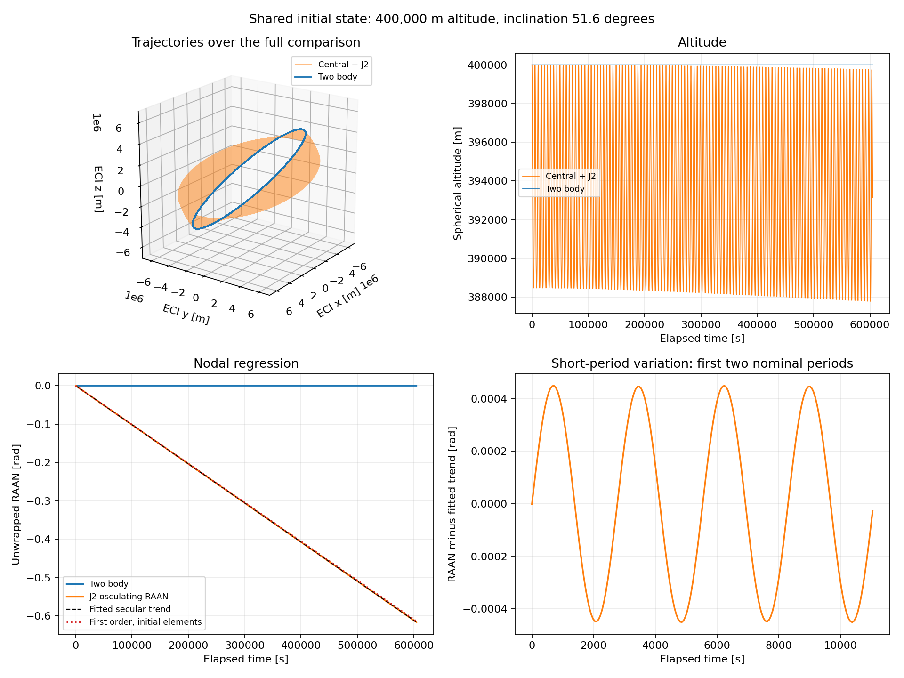

### J2 conservation and convergence

The time-independent potential conserves

$$
E=\tfrac12\|\mathbf v\|^2+\Phi(\mathbf r),
\qquad h_z=(\mathbf r\times\mathbf v)_z.
$$

Axial symmetry gives zero torque about `z`, preserving `h_z`. The full
angular momentum vector rotates as the orbital plane precesses. The two-body
energy `v²/2 - mu/r` exchanges with the J2 potential contribution and also
varies physically. For this run, its maximum change is **52,148.049 m²/s²**,
and the full angular momentum vector changes by **0.475124** of its initial
magnitude. Neither is required to be constant in the J2 tests.

Energy error is referenced to the initial **matching total energy** and
normalized by its absolute value. Axial momentum error is `h_z(t)-h_z(0)`,
normalized by initial `norm(h)` so that the scale remains defined for polar
orbits with zero `h_z`. Absolute errors are also recorded in the JSON report.

| Solver level | `rtol` | Position `atol` [m] | Velocity `atol` [m/s] |
| --- | ---: | ---: | ---: |
| Nominal | 1e-10 | 1e-4 | 1e-7 |
| Tighter | 1e-12 | 1e-6 | 1e-9 |
| Numerical reference | 1e-13 | 1e-7 | 1e-10 |

| Seven-day J2 check | Nominal | Tighter |
| --- | ---: | ---: |
| Maximum absolute total specific energy error [m²/s²] | 1.719590e-2 | 1.114383e-4 |
| Maximum relative total specific energy error | 5.836507e-10 | 3.782358e-12 |
| Maximum absolute `h_z` error [m²/s] | 9.391926 | 0.061234 |
| Maximum `abs(h_z error) / norm(h_0)` | 1.807837e-10 | 1.178675e-12 |
| Maximum position difference from reference [m] | 1.420498 | 0.006375425 |
| Maximum velocity difference from reference [m/s] | 0.001610305 | 7.225751e-6 |

The tighter position difference is **222.81 times smaller**. The reference
run's relative energy and axial momentum errors are 3.975307e-13 and
1.257096e-13. J2 trajectory differences are measured against this finite-
accuracy numerical reference, not an exact J2 trajectory or observations.
The inclined two-body run independently matches the analytical circular
trajectory within 1.544617 m in position over seven days.

The **17 milestone 1 and 2 tests pass**, including all four unchanged
milestone 1 tests.
New checks cover zero-J2 equivalence, force versus finite-difference potential
gradient, equatorial/polar force signs, known element orientations, circular
and equatorial singularities, RAAN unwrapping, correct invariant conservation,
first-order rate agreement within 1%, and tolerance convergence. The nominal
and tighter J2 position and velocity differences must improve by more than
10 times, and both correct relative invariant errors must remain below 1e-8.
`orbit.py` also reproduces the committed milestone 1 plots and report unchanged.

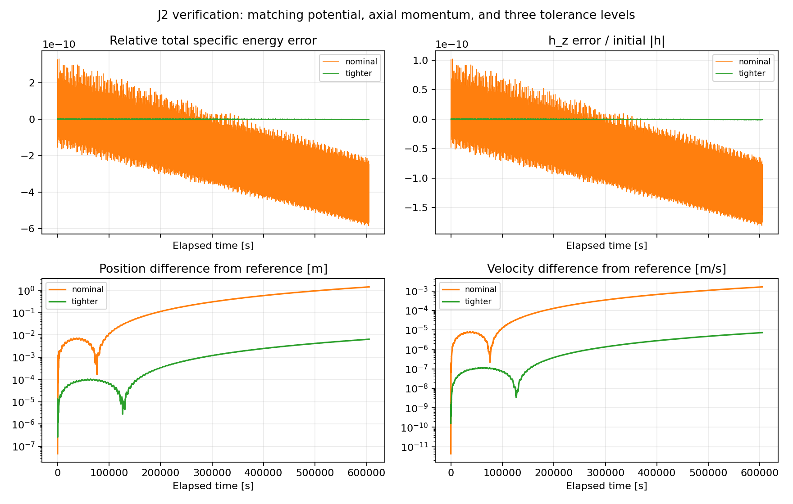

Read `orbit.j2_acceleration` and `orbit.specific_potential` together, then
`elements.osculating_elements`, `j2.fit_raan_drift` and `j2.run_comparison`.
The force integrates Cartesian states; orbital elements are extracted for
analysis, not used as singular integration coordinates. Full-precision
results, initial state, constants and all solver settings are in
[`outputs/j2/validation.json`](outputs/j2/validation.json).

## Milestone 3: atmospheric drag and density sensitivity

### Equations, parameters and frame

The state and initial conditions are exactly those of milestone 2: spherical
altitude 400,000 m, inclination 0.900589894 rad (51.6 degrees), ascending node
on `+x`, and speed `sqrt(mu/r_0)`. The initial velocity is retained because it
defines the common comparison state; it is not an exact circular solution of
J2 plus drag. All cases have identical mass, area, coefficient and initial
Cartesian state. Only the density multiplier changes between drag cases.

The spherical altitude and exponential density are

$$
h=\|\mathbf r\|-R_E,\qquad
\rho(h)=f\rho_{\rm ref}\exp\left[-\frac{h-h_{\rm ref}}{H}\right].
$$

`f` is the dimensionless density multiplier. The following density parameters
are **illustrative teaching choices**, not measurements or a fitted atmosphere.
The spacecraft is also an example; its effective area remains constant even
as the relative flow direction changes.

| Parameter | Default | Unit / meaning |
| --- | ---: | --- |
| Mass `mass_kg` | 1,000 | kg |
| Drag coefficient `cd` | 2.2 | dimensionless |
| Effective cross-sectional area `area_m2` | 10 | m² |
| Reference density `rho_ref_kg_m3` | 4e-12 | kg/m³, illustrative |
| Reference altitude `h_ref_m` | 400,000 | m, spherical altitude |
| Scale height `scale_height_m` | 60,000 | m, illustrative constant |
| Density factors `f` | 0.5, 1, 2 | dimensionless |
| Earth rotation rate `omega_rad_s` | 7.2921150e-5 | rad/s |
| Lower stopping altitude `min_altitude_m` | 200,000 | m, configurable model guard |

The rotation rate is the mean Earth angular velocity listed by the
[IERS numerical standards](https://hpiers.obspm.fr/eop-pc/index.php?index=constants).
The atmosphere rotates rigidly about the **fixed inertial +z axis**, aligned
with the J2 symmetry axis. Without winds,

$$
\boldsymbol\omega_E=(0,0,\omega_E),\qquad
\mathbf v_{\rm atm}=\boldsymbol\omega_E\times\mathbf r,
\qquad \mathbf v_{\rm rel}=\mathbf v-\mathbf v_{\rm atm},
$$

$$
\mathbf a_D=-\tfrac12\rho C_D\frac{A}{m}
\|\mathbf v_{\rm rel}\|\mathbf v_{\rm rel},\qquad
\dot{\mathbf r}=\mathbf v,\quad
\dot{\mathbf v}=\mathbf a_{\rm central}+\mathbf a_{J2}+\mathbf a_D.
$$

See [NASA's atmospheric rotation and drag equations, slide 22](https://ntrs.nasa.gov/api/citations/20160012488/downloads/20160012488.pdf#page=22).
Density times area/mass times speed squared has units m/s². The acceleration
opposes **atmosphere-relative** velocity. At a fixed Cartesian state it scales
linearly with density, coefficient and area, and inversely with mass. Those
parameters are multiplicatively coupled; varying density alone does not
identify which uncertain property would cause an observed trajectory change.

### Running and configuring the experiment

```powershell
python drag.py --days 7
python drag.py --days 7 --mass-kg 1000 --cd 2.2 --area-m2 10 --rho-ref-kg-m3 4e-12 --h-ref-m 400000 --scale-height-m 60000 --min-altitude-m 200000
```

The second command spells out the defaults. Use `--output-dir` for separate
custom runs. Each command runs J2-only, a zero-density check, and all three
density cases at three tolerance levels. Model properties are also accessible
through the small immutable `DragModel`:

```python
import numpy as np
import orbit
from atmosphere import DragModel

state0 = orbit.initial_state(np.deg2rad(51.6))
j2_only = orbit.propagate(state0=state0, duration=604800.0, j2=orbit.J2)
with_drag = orbit.propagate(state0=state0, duration=604800.0, j2=orbit.J2,
                            drag=DragModel(density_multiplier=1.0))
print(with_drag.terminated_early, with_drag.t[-1])
print(with_drag.work_m2_s2[-1])
```

`drag=None` preserves the central/J2 modes. Zero reference density or zero
multiplier skips the drag force and work state exactly. Zero area or coefficient
also disables drag. Mass and scale height must be positive; density, area and
coefficient cannot be negative, and all model parameters must be finite.

The solver terminates on a **downward** crossing of the configured minimum
altitude. It returns a successful stopped solution with the actual root time
and six-component boundary state appended to the output, rather than treating
termination as a failed integration or extending to seven days. Initial
states on or below the limit raise `ValueError`. Event checks limit internal
steps to `PERIOD/16 = 346.553443 s`; output remains at 60 s intervals plus the
event. As in any adaptive event solver, trial stages can evaluate the force
slightly past the boundary while locating the root. No reported trajectory
continues below it. The limit is a guard for this toy profile, not a reentry
prediction or evidence of atmospheric validity down to 200,000 m.

Reports mark later checkpoints unavailable if a run stops early, and comparisons
use only the common available interval. The example cases all complete seven
days without reaching the guard. To see termination on the early J2 radius
oscillation, run `python drag.py --min-altitude-m 395000 --output-dir outputs/drag-guard`.

### Averaging and the reference RTN frame

Instantaneous altitude still contains the roughly 12,000 m J2 oscillations.
Osculating semimajor axis is computed from instantaneous **Keplerian** energy,
`a = -mu / (2 * (v²/2 - mu/r))`; it also oscillates with J2. It is a useful
decay indicator after averaging, but the central + J2 total energy is the one
used for the work check.

`nodal_windows` brackets successive ascending equatorial crossings of the
J2-only orbit, then refines their times using the solver's dense output.
`average_semimajor_axis` performs a time average over each complete window
using 32-point Gauss-Legendre quadrature on dense Cartesian states. Every
case uses the **same reference windows**, approximately 5,533 s long, so
the averages compare matching time intervals. Plot points are placed at
window midpoints; incomplete end orbits are omitted. The drag orbit's own
period changes slightly; these are averages over reference orbital periods,
not a formal osculating-to-mean conversion. The 32-versus-64-point quadrature
test checks that integration of the reference averages is resolved within
0.01 m. Equatorial nodes are undefined and nodal averaging raises `ValueError`.
All existing circular/equatorial angle handling remains unchanged.

For simultaneous Cartesian positions, define the reference frame using the
J2-only state:

$$
\hat{\mathbf R}=\frac{\mathbf r_b}{\|\mathbf r_b\|},\qquad
\hat{\mathbf N}=\frac{\mathbf r_b\times\mathbf v_b}
{\|\mathbf r_b\times\mathbf v_b\|},\qquad
\hat{\mathbf T}=\hat{\mathbf N}\times\hat{\mathbf R}.
$$

Project `r_drag - r_b` onto these orthonormal axes. Positive R points outward;
positive T is transverse/along-track; positive N follows reference angular
momentum. T is perpendicular to R and is not exactly the velocity direction
on an eccentric orbit. RTN coordinates are **projections of a finite position
difference**, not linearised orbital-element changes or distance travelled
along the orbit. In particular, R difference is not altitude difference.

### Actual seven-day density-sensitivity results

Run with Python 3.9.13, NumPy 2.0.2, SciPy 1.13.1 and Matplotlib 3.9.4.
Every nominal case reaches 604,800 s with 10,081 saved states. Instantaneous
values below are evaluated at the exact checkpoint times using dense output.
All differences are drag case minus J2-only. Mean-a differences use the last
**complete reference orbit before** the checkpoint; their precise windows
are 77,464.051–82,997.197 s, 248,991.594–254,524.740 s and
597,579.844–603,112.991 s, respectively, rather than the checkpoint instant.

| Checkpoint | Density factor | Altitude difference [m] | Orbit-averaged a difference [m] |
| --- | ---: | ---: | ---: |
| 24 hours (86,400 s) | 0.5 | -194.687 | -189.764 |
| 24 hours | 1 | -390.060 | -380.129 |
| 24 hours | 2 | -782.882 | -762.671 |
| 72 hours (259,200 s) | 0.5 | -486.903 | -597.484 |
| 72 hours | 1 | -980.683 | -1,200.956 |
| 72 hours | 2 | -1,989.827 | -2,426.363 |
| Seven days (604,800 s) | 0.5 | -1,920.655 | -1,434.719 |
| Seven days | 1 | -3,839.229 | -2,904.704 |
| Seven days | 2 | -7,678.746 | -5,958.719 |

| Checkpoint | Density factor | R difference [m] | T difference [m] | N difference [m] |
| --- | ---: | ---: | ---: | ---: |
| 24 hours | 0.5 | -211.411 | 15,036.314 | -8.744 |
| 24 hours | 1 | -457.107 | 30,106.406 | -17.424 |
| 24 hours | 2 | -1,052.299 | 60,348.305 | -34.588 |
| 72 hours | 0.5 | -1,845.773 | 135,592.658 | 82.795 |
| 72 hours | 1 | -6,453.264 | 272,057.956 | 173.350 |
| 72 hours | 2 | -24,178.580 | 547,432.753 | 377.764 |
| Seven days | 0.5 | -42,609.111 | 740,698.106 | -377.670 |
| Seven days | 1 | -168,788.146 | 1,484,251.617 | -1,002.299 |
| Seven days | 2 | -681,443.770 | 2,941,186.940 | -2,938.872 |

Higher density produces greater energy loss and semimajor-axis decay. The
response is close to linear early on, but not exactly linear over seven days:
decay changes the encountered density and velocity, feeding back into drag.
Although drag opposes relative motion, a lower orbit has a higher mean motion;
the accumulated orbital phase moves ahead of the J2-only reference. This
explains the large positive T differences. At large phase separation, chord
geometry also gives a substantial negative R projection, much larger than
the actual change of orbital radius. N differences include the plane response
to co-rotation and different J2 precession histories as the elements evolve.

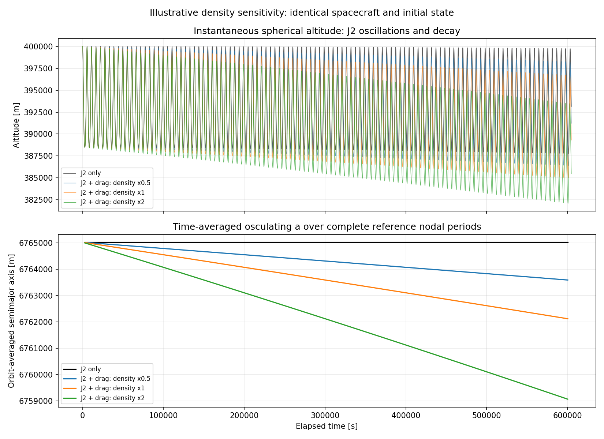

| Density factor | Density range [kg/m³] | Drag magnitude range [m/s²] | Minimum altitude [m] |
| --- | --- | --- | ---: |
| 0.5 | 2.000e-12 to 2.508e-12 | 1.197e-6 to 1.504e-6 | 386,412.422 |
| 1 | 4.000e-12 to 5.136e-12 | 2.394e-6 to 3.080e-6 | 385,006.037 |
| 2 | 8.000e-12 to 1.078e-11 | 4.788e-6 to 6.469e-6 | 382,083.388 |

Density and acceleration oscillate with altitude and increase as the orbit
decays. All cases start at a maximum spherical altitude of 400,000 m. Bounds
are maxima/minima on the saved grid, not rigorous bounds between samples.

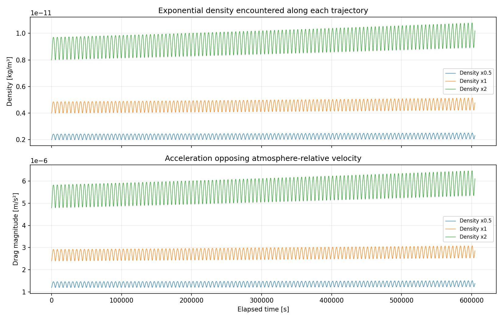
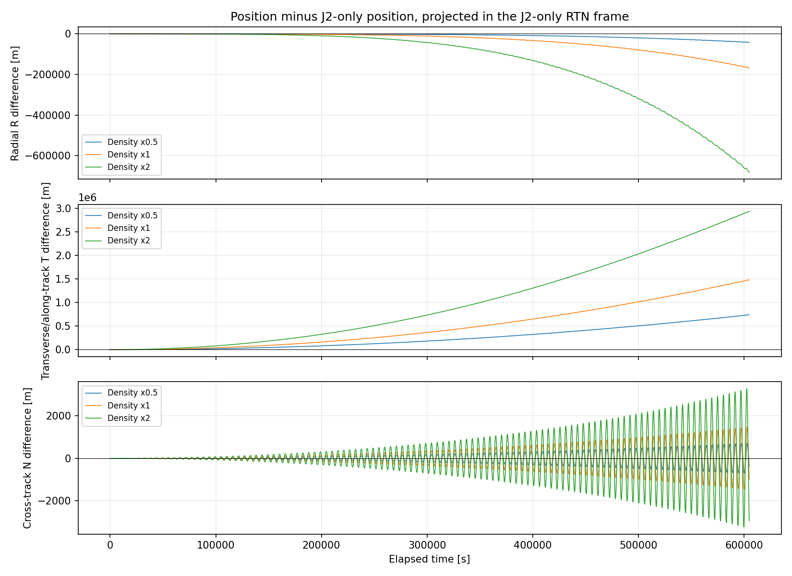

### Work-energy verification and numerical convergence

For the same time-independent central + J2 potential used in milestone 2,

$$
E=\tfrac12\|\mathbf v\|^2+\Phi(\mathbf r),\qquad
\frac{dE}{dt}=\mathbf v\cdot\mathbf a_D,\qquad
E(t)-E(0)=W(t)=\int_0^t\mathbf v\cdot\mathbf a_D\,dt.
$$

The gravitational terms cancel because `a_gravity = -grad(Phi)`. The velocity
in this identity is **inertial** velocity, even though the drag force uses
relative velocity. Using `v_rel dot a_drag` instead would describe a different
work balance involving the atmosphere's rotational motion. Relative-frame
drag power is always nonpositive; inertial-frame drag power is negative in
this example, but need not be negative for every possible state in a rotating
atmosphere. Neither E nor h_z is required to remain constant with drag.

DOP853 advances position and velocity as before, evaluating gravity, density,
relative velocity and drag at its trial stage states. With active drag it
also advances a seventh scalar `W`, with `W(0)=0` and derivative
`v dot a_drag`, at the same stages and interpolation order. W has no feedback
into the physical derivatives. `propagate` returns six-component `y`/`sol`,
plus `work_m2_s2` and, when dense output is requested, `work_sol`.
This avoids approximating accumulated work with a coarse 60 s trapezoidal
sum. A separate test integrates inertial drag power with adaptive `quad`
over one period and agrees with W within 1e-6 m²/s²; replacing inertial
velocity with relative velocity fails that check by more than 1%.

The diagnostic residual is `E(t) - E(0) - W(t)`, with a relative scale of
`abs(E(0))`, not energy change divided by itself. The three tolerance levels
use the Cartesian tolerances in milestone 2 and work absolute tolerances
1e-5, 1e-7 and 1e-8 m²/s². The reference remains a finite-accuracy numerical
run. All levels use the same physics and initial state.

| Density factor | Nominal max work residual [m²/s²] | Tighter max work residual [m²/s²] | Nominal max position difference from reference [m] | Tighter max position difference [m] |
| --- | ---: | ---: | ---: | ---: |
| 0.5 | 1.873038e-2 | 1.218830e-4 | 1.564719 | 0.007000831 |
| 1 | 1.867585e-2 | 1.209863e-4 | 1.577089 | 0.006853069 |
| 2 | 1.878921e-2 | 1.223812e-4 | 1.603643 | 0.007238184 |

The nominal work residual is at most 6.3773e-10 of initial total energy;
the tighter residual is at most 4.1538e-12. Reference residuals range from
1.2418e-5 to 1.2908e-5 m²/s². Tighter maximum position differences improve
by factors of 223.50, 230.13 and 221.55. Maximum velocity differences also
fall from about 0.0018 m/s to approximately 8e-6 m/s. These errors are far
smaller than the differences caused by the chosen density factors.

For factor 1, final nominal energy change is -12,767.993312 m²/s² and
integrated work is -12,767.978349 m²/s²; the roughly 0.015 m²/s² discrepancy
is the numerical work-balance residual. Physical energy loss and numerical
work-balance error have different
meanings.

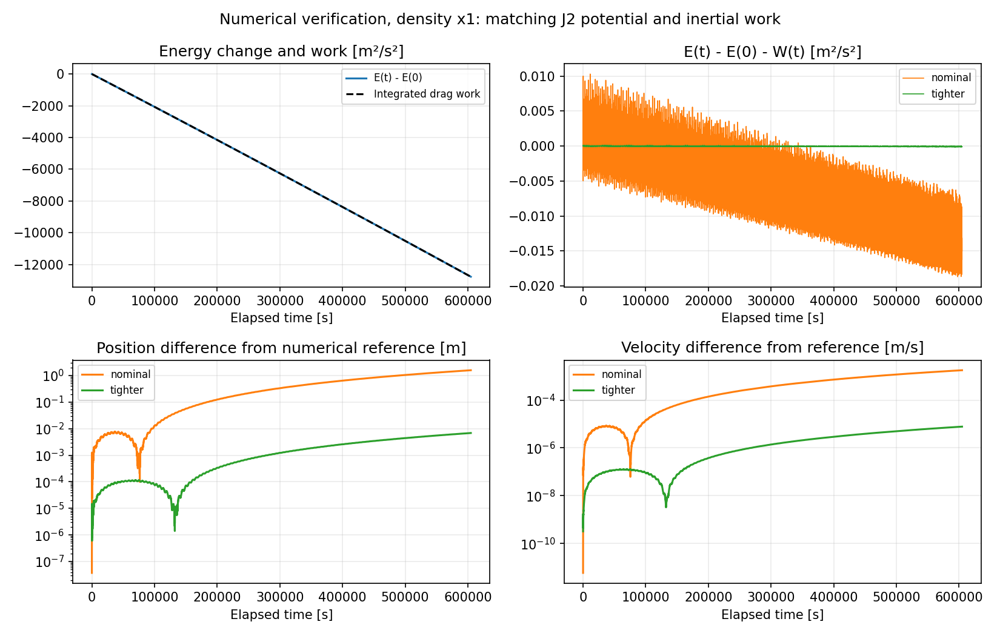

All **34 tests pass**: the unchanged 17 previous tests and 17 drag tests.
They check exponential density, force scaling and direction, co-rotation,
zero-density equivalence, RTN orientation and distance preservation, guarded
termination with the actual boundary state, averaging, independent work
quadrature, shared initial states, all checkpoint comparisons and tolerance
convergence at every density factor. The seven-day zero-density maximum
Cartesian state difference is **exactly zero**. Both original scripts reproduce
their committed plots and JSON reports unchanged, and `pip check` reports no
broken requirements.

Full-precision checkpoint values, averaging intervals, solver settings, work
residuals and convergence results are in
[`outputs/drag/validation.json`](outputs/drag/validation.json). To explain the
implementation, follow `DragModel.density` → `relative_velocity` →
`acceleration`, then `orbit.propagate` and `drag.work_energy_diagnostics`.
The initial state defines the common experiment, stage evaluations advance
the orbit, and the force checks, work balance and convergence establish
numerical consistency with the specified toy model.

### Scope and limitations

This is a **density-sensitivity study**, not a validated space-weather
forecast or a calibrated orbit prediction. The exponential profile has one
constant scale height and is spherical and static. It contains no solar or
geomagnetic inputs, latitude/longitude variation, local solar time, composition
or temperature evolution, winds or atmospheric super-rotation. Constant Cd,
area and mass omit attitude changes, gas-surface interaction variability and
spacecraft operations. The fixed rotation vector and generic ECI frame have
no epoch or Earth-orientation corrections. Altitudes use the original mean
spherical radius, not ellipsoidal or geodetic height. Higher gravity harmonics,
third bodies, radiation pressure and manoeuvres remain absent.

Real density and drag are influenced by space weather and uncertain spacecraft
properties, as discussed in
[NASA's collision-avoidance handbook, Appendix N](https://www.nasa.gov/wp-content/uploads/2024/04/ca-handbook-rev-1-appendix-n-update-march-2024.pdf).
Factors 0.5 and 2 are prescribed experiments, not a confidence interval or
forecast ensemble. Small solver errors verify these equations; they do not
validate the density choices or establish real-world prediction accuracy.
No tracking observations or operational atmosphere have been used. Milestone 4
adds an Orekit implementation comparison using the same illustrative profile.

## Milestone 4: independent comparison with Orekit

### Optional wrapper and tested Windows environment

The maintained [JPype wrapper documentation](https://pypi.org/project/orekit-jpype/13.1.9.0/)
was checked before installation. This wrapper loads Orekit's Java classes into
an in-process JVM and supports implementing Java interfaces in Python. The
chosen release requires JPype 1.7.1; Java 11 or later is supported. The tested
64-bit Python/Java combination and all installed Python packages are recorded
in `requirements-orekit.txt` and the saved validation report.

| Component | Version actually used |
| --- | --- |
| Windows Python | 3.9.13, 64-bit |
| Orekit JPype wrapper | 13.1.9.0 |
| JPype | 1.7.1 |
| Bundled Orekit Java library | 13.1.9 |
| Bundled Hipparchus integrators | 4.0.3 |
| Java runtime | Oracle JDK 17.0.3+8-LTS-111, 64-bit |
| NumPy / SciPy / Matplotlib | 2.0.2 / 1.13.1 / 3.9.4 |

The comparison uses an isolated `.venv-orekit/`, which Git ignores. The
original `.conda/`, `requirements.txt` and `environment.yml` remain unchanged.
On the development machine the system Python launcher's venv failed; the
working Conda Python was used to create the venv. These are the tested Windows
PowerShell commands, assuming the existing `.conda` environment from setup
above and an installed 64-bit JDK at the stated location:

```powershell
# Use the working Python 3.9.13 and its Conda DLL paths to create a separate venv.
$env:PATH = "$PWD\.conda;$PWD\.conda\Library\bin;$PWD\.conda\Scripts;$env:PATH"
.\.conda\python.exe -m venv .venv-orekit
$env:JAVA_HOME = "C:\Program Files\Java\jdk-17.0.3"
$env:PATH = "$env:JAVA_HOME\bin;$env:PATH"
$env:MPLCONFIGDIR = "$PWD\.mplconfig"
.\.venv-orekit\Scripts\python.exe -m pip install -r requirements-orekit.txt
.\.venv-orekit\Scripts\python.exe orekit_compare.py --smoke-only
.\.venv-orekit\Scripts\python.exe orekit_compare.py --forces-only
.\.venv-orekit\Scripts\python.exe orekit_compare.py
.\.venv-orekit\Scripts\python.exe -m unittest -v
.\.venv-orekit\Scripts\python.exe -m pip check
```

Set `JAVA_HOME`, Java's bin directory and `MPLCONFIGDIR` in each new shell
used for Orekit. With a healthy standalone Python installation,
`py -3.9 -m venv .venv-orekit` can replace the Conda-based creation command.
A different compatible Java 17 build needs its own `JAVA_HOME`; check the
runtime printed by `--smoke-only` when assessing reproducibility. Python and
Java must have matching 64-bit architectures. The code starts the JVM before
importing Java classes. A JVM cannot be restarted within the same Python
process; a new script invocation starts a new process.

`--smoke-only` imports the wrapper and propagates a central-gravity orbit
numerically for 60 s, then compares with the circular solution. It passed
with maximum position error **1.863264e-8 m** and velocity error
**1.932676e-12 m/s** on the 10 s grid. `--forces-only` runs all force/environment
checks without a long integration. The full command repeats both checks and
runs the cases in order: central, J2, nominal drag, half density, double density.
Each case must pass a reference-level consistency gate before the next case.
Use `--show` or `--output-dir path` as in the other scripts.

No Orekit data download is needed for this experiment. GCRF and TAI are
built-in, gravity coefficients are supplied explicitly, and the atmosphere
uses the prescribed ideal rotation. No UTC conversion, EOP, solar ephemeris
or operational density model is requested. Orekit remains optional: the
base environment can run all original scripts and tests, and the new tests
skip explicitly when the wrapper is absent.

### Common initial conditions, axes and epoch

For this comparison, interpret the project's existing ideal ECI Cartesian
components as **GCRF** components in both propagators. GCRF is the common
Earth-centred, quasi-inertial frame returned by `FramesFactory.getGCRF()`.
The toy gravity symmetry axis and rotation vector are defined to be its
fixed `+z` direction; they are not transformed to the actual time-dependent
terrestrial pole. This specifies the comparison frame without changing any
milestone 1–3 calculation or stored output.

Both implementations start at **2026-01-01 00:00:00 TAI**. SciPy's `t=0`
corresponds to Orekit's `AbsoluteDate` at that epoch; all output times are
elapsed SI seconds. TAI avoids needing a leap-second table. The static models
do not depend on the particular epoch beyond defining atmosphere-frame angle.

Every new comparison uses the milestone 3 inclined state:

$$
\mathbf r_0=(6771000,0,0)\ \mathrm m,\qquad
\mathbf v_0=(0,4765.8176194107145,6012.965361426416)\ \mathrm{m/s}.
$$

The central comparison is inclined at 51.6 degrees too, so the same state is
used across all new cases. The original milestone 1 CLI remains equatorial.
The circular analytical comparison is rotated by that inclination. Position,
velocity, mass and all force constants are passed without unit conversion or
retuning of the initial speed.

### Matching the built-in force models

Orekit evaluates **its own force implementations**. No Python acceleration
or density function is called by an Orekit force. `UniformRotation` implements
only the frame transformation through Orekit's `TransformProvider` interface.
The API conventions were checked against the
[official Orekit 13.1.9 Java sources](https://repo.maven.apache.org/maven2/org/orekit/orekit/13.1.9/orekit-13.1.9-sources.jar)
when the hosted Javadoc was inaccessible.

| Quantity or model choice | Matched definition |
| --- | --- |
| Central gravity | `mu = 3.986004418e14 m³/s²`, one `NewtonianAttraction` |
| J2 gravity reference radius | 6,378,137 m |
| Positive J2 | 1.08263e-3 |
| Fully normalized coefficient | `Cbar_20 = -J2/sqrt(5) = -4.8416685489611946e-4` |
| Enabled harmonics | Degree 2, order 0 only; other non-central coefficients zero |
| J2 symmetry axis | Fixed GCRF z; gravity model's body frame is GCRF |
| Altitude/density reference radius | 6,371,000 m; `h = norm(r) - R_E` |
| Orekit shape | `OneAxisEllipsoid(R_E, 0.0, atmosphere_frame)`: flattening exactly zero |
| Nominal reference density | 4e-12 kg/m³, multiplied by 0.5, 1 or 2 |
| Reference altitude / scale height | 400,000 m / 60,000 m |
| Density implementation | Orekit `SimpleExponentialAtmosphere` on the sphere |
| Atmosphere rotation | Constant `omega = (0,0,7.2921150e-5) rad/s` in GCRF |
| Atmospheric velocity | Built-in `getVelocity`, equivalent to `omega cross r` |
| Spacecraft | Constant 1,000 kg mass, 10 m² effective area, Cd = 2.2 |
| Drag implementation | Orekit `DragForce` with `IsotropicDrag` |
| Termination | Stop on downward spherical-altitude crossing at 200,000 m |
| Output grid | Central: 0–86,400 s every 10 s; others: 0–604,800 s every 60 s |

`GravityFieldFactory.getNormalizedProvider` constructs a constant degree-2,
order-0 field directly from coefficients; no Earth gravity file is loaded.
For fully normalized zonal polynomials, `Pbar_20 = sqrt(5)*P2`, so positive
J2 means **negative** `Cbar_20 = -J2/sqrt(5)`. Using the unnormalized `-J2`
in this provider would make the J2 force too large by `sqrt(5)`.

`HolmesFeatherstoneAttractionModel` contributes the **non-central** gravity
terms. `NumericalPropagator.setIgnoreCentralAttraction(True)` disables automatic
central-force addition, then one explicit `NewtonianAttraction` is added.
The force list is checked in tests. C00 is set to 1 in the provider, but is
not applied as another central acceleration by Holmes–Featherstone. There
are no tides, degree-1 terms, tesseral terms or higher zonal harmonics.

The atmosphere frame shares GCRF's origin and z axis and coincides with its
axes at the epoch. Its parent-to-child transform is a **passive** rotation
by `omega*t` about z: an inertial `+x` position has rotating-frame components
`r*(cos(omega*t), -sin(omega*t), 0)`. The transform also supplies the positive
angular rate. Orekit then transforms a point stationary in the atmosphere
back to GCRF and obtains `omega cross r` through its own atmosphere velocity
implementation. Static, kinematic and field interface methods are implemented
explicitly; this also avoids an overloaded default-method dispatch error
encountered with JPype during development.

Zero flattening makes Orekit's body height the required spherical height.
No ellipsoidal height or ITRF rotation is substituted. Forcing a full Earth
rotation frame here would introduce a different physical model and extra data
dependencies. The gravity harmonic's equatorial reference radius remains
distinct from the atmosphere/altitude radius, exactly as in milestones 2–3.

`AltitudeDetector` uses the same sphere and its default stop-on-descending
behavior. Its maximum checking interval is `PERIOD/16 = 346.553443 s`, with
root convergence threshold 1e-9 s. Both propagators reject initial states at
or below the limit and include their terminal state. The comparisons use the
common available interval and never extrapolate a stopped Orekit ephemeris.
All main cases reach their requested durations; a separate 395,000 m guard
test checks boundary states and event-time agreement.

### Force and atmosphere checks before integration

Five shared Cartesian states cover the ascending and opposite equators,
northern/southern oblique positions, and a near-polar position. Their altitudes
include 390,000, 400,000 and 430,000 m. Each is evaluated at elapsed times
0, 86,400 and 604,800 s for all three density multipliers: **45 checks**.
Central, J2 and drag accelerations are compared separately, as are spherical
altitude, density and atmospheric velocity. A mismatch stops the experiment
before a long propagation; these gates are consistency thresholds, not bounds
on trajectory accuracy.

| Shared-state quantity | Maximum measured difference | Gate |
| --- | ---: | ---: |
| Central acceleration [m/s²] | 2.035072e-15 | 2e-12 |
| J2 acceleration [m/s²] | 9.055522e-18 | 2e-13 |
| Drag acceleration [m/s²] | 2.601960e-19 | 1e-16 |
| Spherical altitude [m] | 3.026798e-9 | 1e-6 |
| Relative density difference | 5.042896e-14 | 1e-12 |
| Atmospheric velocity difference [m/s] | 5.934627e-13 | 1e-9 |

These differences are consistent with floating-point evaluation and frame
roundoff. In particular, the checked atmosphere velocity establishes rotation
sign and rate independently of the drag acceleration check. The raw states,
both libraries' force vectors, densities and velocities are retained in the
JSON report. No discrepancy required changing the intended force equations.

### Propagators and independent tolerance experiments

In Orekit, a `CartesianOrbit` assigns frame, epoch and mu to the initial
position/velocity; `SpacecraftState` adds spacecraft mass. `NumericalPropagator`
holds the force list and integrates **Cartesian** components with the
Hipparchus `DormandPrince853Integrator`. Setting `OrbitType.CARTESIAN` avoids
propagating singular Keplerian angles. An ephemeris generator records its
accepted-step interpolation, allowing positions and velocities to be extracted
at the same output times used for SciPy. Those ephemeris samples do not trigger
new force integration.

Both solvers adapt their internal steps. Orekit's seven primary components
are position, velocity and **mass**, with zero mass derivative. SciPy's drag
run has position, velocity and **specific drag work**, which has no feedback
into the physical state. Neither includes variable attitude or mass loss.

| Level | Cartesian `rtol` | Position `atol` [m] | Velocity `atol` [m/s] | Orekit mass `atol` [kg] | SciPy drag work `atol` [m²/s²] |
| --- | ---: | ---: | ---: | ---: | ---: |
| Nominal | 1e-10 | 1e-4 | 1e-7 | 1e-9 | 1e-5 |
| Tighter | 1e-12 | 1e-6 | 1e-9 | 1e-11 | 1e-7 |
| Numerical reference | 1e-13 | 1e-7 | 1e-10 | 1e-12 | 1e-8 |

Orekit uses the Cartesian `rtol` on all seven components, a 0.001 s minimum
step and 346.553443 s maximum step. SciPy uses its existing drag-work equations
and the same maximum step when the altitude guard is enabled. Component
scaling, error norms and step-control details differ between libraries.
Matching tolerance numbers does not imply identical accuracy.

For every case, the report contains five cross-library comparisons: both
nominal, **only SciPy tighter**, **only Orekit tighter**, both tighter and
both reference. It also compares nominal and tighter runs with each library's
own reference. Thus one solver's tolerance can change while the other remains
fixed. Force matching is checked first; changing numerical error while keeping
the forces fixed distinguishes integration effects from model mismatch.

### Actual trajectory differences

The values below are norms of **Orekit minus SciPy** Cartesian differences.
Each cross-library RTN frame follows the SciPy trajectory at the indicated
tolerance level, using the same R/T/N definitions as milestone 3. Orekit is
not designated as exact truth. Checkpoints use exact elapsed times; maxima
refer to the shared saved grid, including dense interpolation, and are not
rigorous bounds between samples.

Checkpoint results with **both solvers tighter (`rtol=1e-12`)**:

| Model | Elapsed time [s] | Position difference [m] | Velocity difference [m/s] |
| --- | ---: | ---: | ---: |
| Central | 86,400 | 3.105387e-6 | 3.604511e-9 |
| J2 | 86,400 | 7.836191e-6 | 8.224018e-9 |
| J2 | 259,200 | 1.021348e-4 | 1.156841e-7 |
| J2 | 604,800 | 8.261475e-4 | 9.365627e-7 |
| J2 + drag, density x1 | 86,400 | 1.142594e-5 | 1.302516e-8 |
| J2 + drag, density x1 | 259,200 | 9.719984e-5 | 1.102567e-7 |
| J2 + drag, density x1 | 604,800 | 4.472369e-4 | 5.078548e-7 |
| J2 + drag, density x0.5 | 86,400 | 9.000585e-6 | 1.032361e-8 |
| J2 + drag, density x0.5 | 259,200 | 4.828454e-5 | 5.497235e-8 |
| J2 + drag, density x0.5 | 604,800 | 2.110493e-4 | 2.393512e-7 |
| J2 + drag, density x2 | 86,400 | 3.095509e-6 | 3.408477e-9 |
| J2 + drag, density x2 | 259,200 | 2.323526e-5 | 2.633888e-8 |
| J2 + drag, density x2 | 604,800 | 1.643102e-4 | 1.867115e-7 |

86,400 s is 24 hours, 259,200 s is 72 hours, and 604,800 s is seven days.
The central experiment ends at 24 hours; its later checkpoints are explicitly
unavailable in the report. All other cases have 10,081 shared output times;
the central case has 8,641.

Maximum position differences over each full run [m]:

| Model | Both nominal | Both tighter | Both reference |
| --- | ---: | ---: | ---: |
| Central, 24 hours | 2.006717e-3 | 1.992969e-5 | 2.131822e-6 |
| J2, seven days | 1.327880e-1 | 8.262973e-4 | 2.706347e-4 |
| Drag x1, seven days | 7.648446e-4 | 4.472369e-4 | 1.438649e-4 |
| Drag x0.5, seven days | 5.699617e-4 | 2.110858e-4 | 1.992881e-4 |
| Drag x2, seven days | 6.703450e-4 | 1.643102e-4 | 2.157987e-4 |

Maximum velocity differences over each full run [m/s]:

| Model | Both nominal | Both tighter | Both reference |
| --- | ---: | ---: | ---: |
| Central, 24 hours | 9.771297e-7 | 6.183878e-9 | 1.252599e-9 |
| J2, seven days | 1.505360e-4 | 9.365627e-7 | 3.070375e-7 |
| Drag x1, seven days | 7.670160e-7 | 5.078548e-7 | 1.634181e-7 |
| Drag x0.5, seven days | 5.540577e-7 | 2.393512e-7 | 2.264177e-7 |
| Drag x2, seven days | 6.779232e-7 | 1.867115e-7 | 2.451680e-7 |

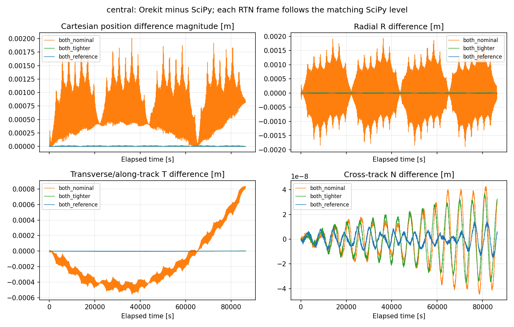
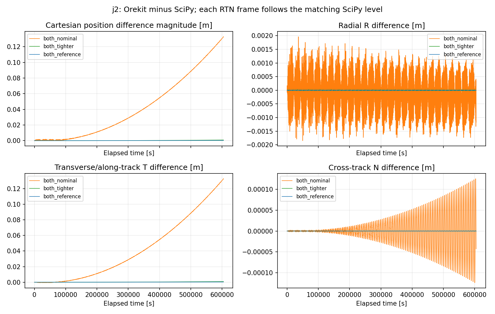
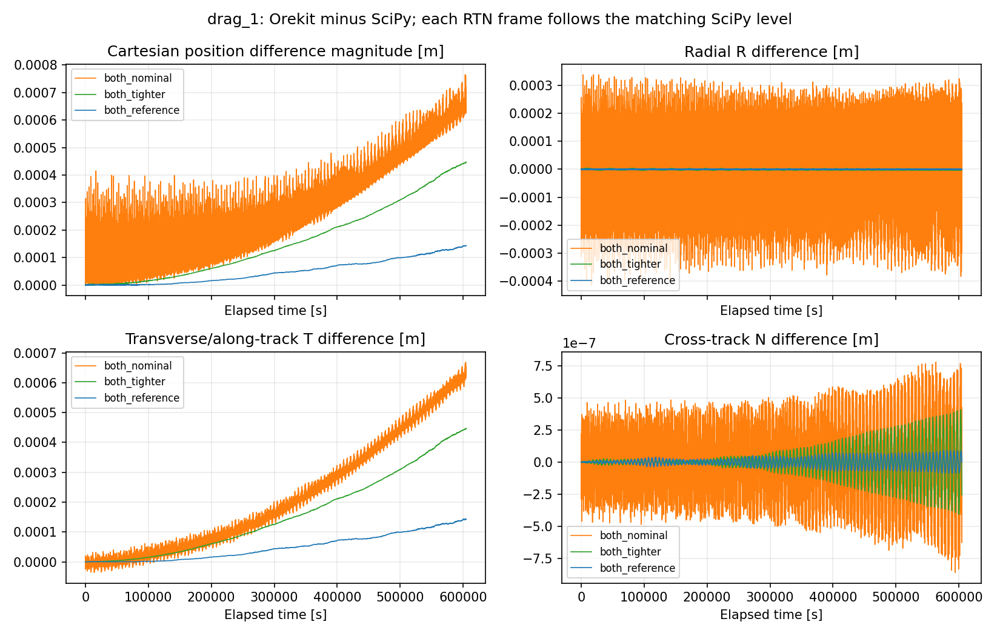
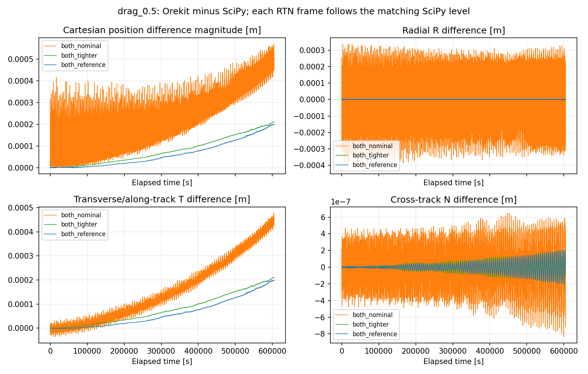
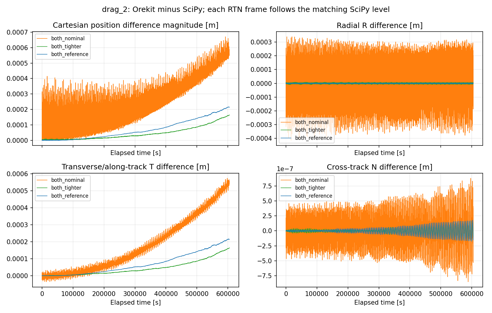

### Interpreting agreement and convergence

The strikingly small nominal drag discrepancy does **not** mean either
nominal trajectory is accurate to that difference. SciPy DOP853 and Hipparchus
Dormand–Prince 8(5,3) are independent implementations of the **same RK family**.
Their accumulated numerical biases can be correlated and cancel in a
cross-library subtraction. For nominal-density drag:

| Comparison | Maximum position difference over seven days [m] |
| --- | ---: |
| Both nominal, Orekit versus SciPy | 0.000764845 |
| Tighten only SciPy, keep Orekit nominal | 1.570871 |
| Tighten only Orekit, keep SciPy nominal | 1.569789 |
| SciPy nominal versus its own reference | 1.577089 |
| Orekit nominal versus its own reference | 1.577580 |
| SciPy tighter versus its own reference | 0.006853069 |
| Orekit tighter versus its own reference | 0.007156575 |

Tightening one solver reveals the other solver's integration error that was
mostly cancelled when both were nominal. The independent nominal-to-tighter
position differences shrink by factors **230.13** for SciPy and **220.44** for
Orekit in this case. Both position and velocity differences shrink by more
than 10 times in each library for every case. The drag convergence factors
span roughly 220–230; the central case gives 67.91 and 71.35.

The reference level has finite error too. In the central case its maximum
position errors relative to the exact inclined circle are **8.757278e-6 m**
for SciPy and **9.718192e-6 m** for Orekit, while the cross-library difference
is only 2.131822e-6 m. This independently demonstrates why agreement can be
closer than either trajectory's error. Cross-library differences need not
decrease monotonically: drag x2's reference-to-reference difference is slightly
larger than its tighter-to-tighter difference. Error cancellation and changing
step histories affect that difference; it is not an absolute error estimator.

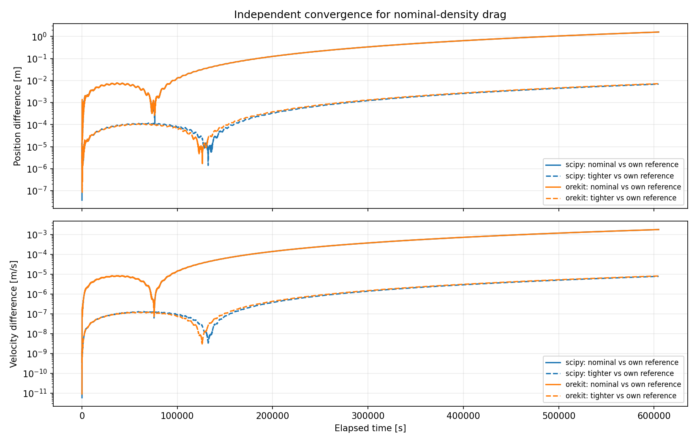

All **45 tests pass** in the isolated Orekit environment, including the 34
unchanged previous tests. The original environment passes those 34 and skips
the 11 optional tests. Both environments pass `pip check`. New checks cover
force/density/velocity matching, normalization and force lists, rotation sign
and field transforms, zero-density equivalence in Orekit, configurable drag
properties, spherical stopping events, matching initial states and times,
constant mass, circular-reference errors, independent convergence and RTN
norm consistency. Earlier code and outputs are preserved unchanged.

The smoke test, force preflight, exact model choices, per-library tolerances,
force lists, RHS evaluation counts, all checkpoint values and every tolerance
combination are in [`outputs/orekit/validation.json`](outputs/orekit/validation.json).
Read `OrekitModel` for model construction, then `check_force_models`, `run_case`
and `run_comparisons`. The physics is checked at shared states before trajectory
differences are interpreted; the tolerance experiment then measures numerical
sensitivity while holding the physical model fixed.

### What this comparison establishes

The results support consistency between the project's equations and Orekit's
built-in implementations **for these matched ideal models and initial states**.
They can expose sign, normalization, reference-radius, frame, relative-velocity
or integration mistakes. They do not make Orekit exact truth, prove error
bounds for all orbits, or validate the chosen density against the real
thermosphere. Both integrations use the same RK family, so their algorithmic
errors are not fully independent even though the force and integrator code
come from separate implementations.

This remains an illustrative density-sensitivity study. No tracking data,
space-weather forecast or realistic Earth-orientation/gravity/atmosphere
model has been introduced. Matching simplified assumptions can yield close
agreement while both predictions omit the same real forces and uncertainties.

## Further work

Milestones 1–4 are implemented. Possible next studies include a different
integration family to examine correlated numerical error, then an explicitly
scoped operational density model or additional gravity terms, with observational
validation kept distinct from numerical implementation checks.
