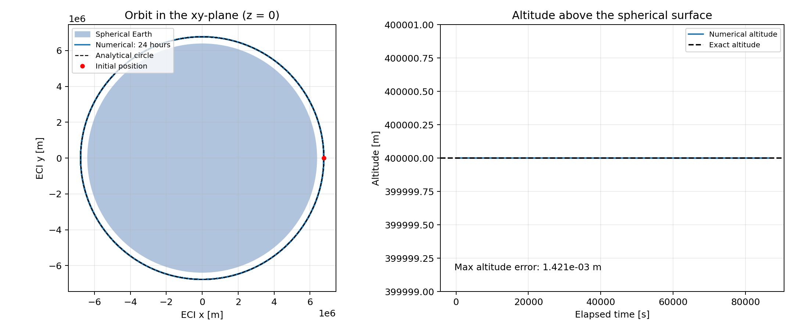
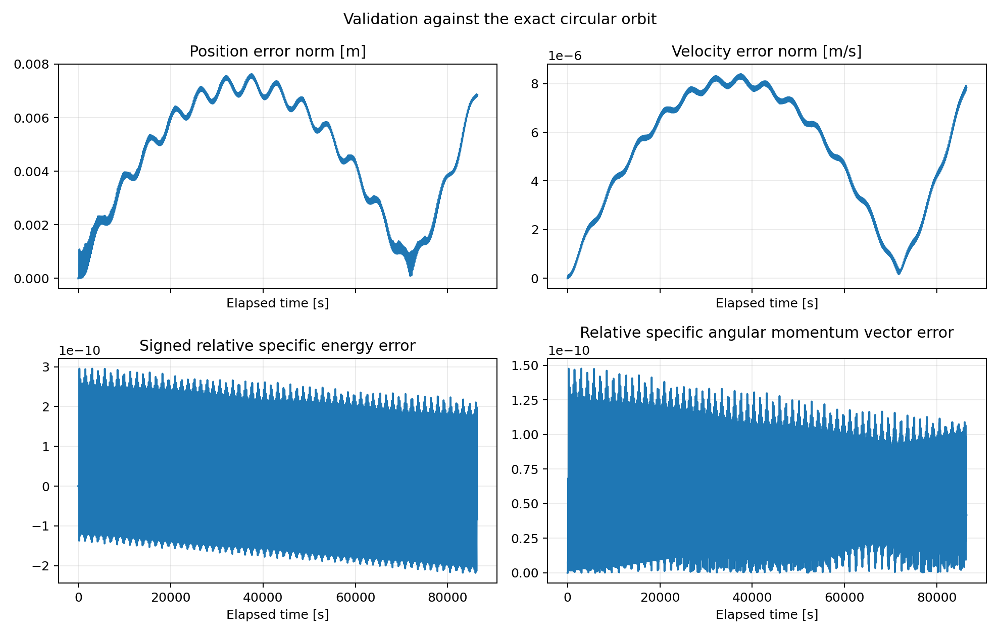

# leo-propagator

A learning project for building and understanding satellite orbit propagation
in Python, with an eventual comparison against Orekit. The implementation is
kept small so that the physical model, numerical integration and verification
can be read and explained directly.

**Milestone 1 is implemented:** a satellite initially in a circular orbit
400,000 m above a spherical Earth, subject only to Earth's central gravity.
All calculations, saved values and plot axes use metres and seconds.

## Implemented capabilities

- Integrate all six Cartesian position and velocity components for 86,400 s
  in a clearly defined Earth-centred inertial frame using `solve_ivp` and DOP853.
- Calculate the circular speed, analytical orbital period and exact trajectory.
- Compare numerical position and velocity with the analytical solution at
  matching times, and quantify altitude, specific energy and angular momentum errors.
- Check convergence by repeating the propagation with tighter tolerances.
- Save orbit, altitude and validation figures, plus a JSON report, and run four
  automated physics and numerical verification tests.

## Setup and run

Run the commands from the repository root. Use Python 3.9 through 3.12 with
the versions pinned in `requirements.txt`. Local environments are ignored by
Git; the environment definitions remain in the repository.

To create an environment with Conda (Python 3.9, matching the validation run's
Python version family):

```powershell
conda env create --prefix ./.conda --file environment.yml
conda activate ./.conda
python orbit.py
python -m unittest -v
python -m pip check
```

Alternatively, on Windows with Python 3.12 installed:

```powershell
py -3.12 -m venv .venv
.\.venv\Scripts\python.exe -m pip install -r requirements.txt
.\.venv\Scripts\python.exe orbit.py
.\.venv\Scripts\python.exe -m unittest -v
.\.venv\Scripts\python.exe -m pip check
```

On Linux/macOS with Python 3.12 installed:

```bash
python3.12 -m venv .venv
.venv/bin/python -m pip install -r requirements.txt
.venv/bin/python orbit.py
.venv/bin/python -m unittest -v
.venv/bin/python -m pip check
```

If the project's `.conda` environment already exists, activate it instead of
creating it again. For a direct invocation in PowerShell without Conda activation:

```powershell
# Supply the DLL paths normally set by conda activation.
$env:PATH = "$PWD\.conda;$PWD\.conda\Library\bin;$PWD\.conda\Scripts;$env:PATH"
.\.conda\python.exe -m pip install -r requirements.txt
.\.conda\python.exe orbit.py
.\.conda\python.exe -m unittest -v
```

The script saves figures without opening windows. Add `--show` for plot windows
or `--output-dir path` to select the output directory. Every normal run also
performs the tighter-tolerance comparison.

## Files and outputs

- `orbit.py`: constants, initial state, equations, solver, analytical reference,
  diagnostics and plotting. No additional dynamics or propagation frameworks.
- `test.py`: four physics and full-day validation checks, using `unittest`.
- `requirements.txt`: NumPy, SciPy and Matplotlib versions used for this milestone.
- `outputs/orbit_and_altitude.png`: the numerical orbit overlaid on the exact
  circle, and altitude versus elapsed time.
- `outputs/validation.png`: position, velocity, energy and angular momentum errors.
- `outputs/validation.json`: model constants, solver settings, package versions,
  maximum and final errors, and the tighter-tolerance comparison.





## Frame, units and assumptions

The frame is an idealised, right-handed Earth-centred inertial (ECI) frame:

- Origin: the centre of a stationary, spherical Earth.
- `+z`: a fixed reference north-pole direction.
- `+x`: an arbitrary fixed direction in the reference equatorial plane.
- `+y`: completes the right-handed system, with unit vector `z cross x`.

The axes stay fixed throughout the integration; they do not rotate with Earth.
The initial orbit lies in the `xy` plane and travels counterclockwise when
viewed from `+z`. This defines an idealised frame, not a full implementation of
GCRF, EME2000 or Earth orientation transformations. Time is elapsed seconds
from an arbitrary initial instant, so no calendar epoch or time-scale conversion
is needed for this autonomous model.

| Quantity | Adopted value | SI unit |
| --- | ---: | --- |
| Earth gravitational parameter, `mu = GM` | 3.986004418e14 | m³/s² |
| Spherical Earth radius, `R_E` | 6,371,000 | m |
| Initial altitude, `h_0` | 400,000 | m |
| Initial orbital radius, `r_0 = R_E + h_0` | 6,771,000 | m |
| Propagation duration | 86,400 | s |

The radius is the volumetric mean radius listed in
[NASA's Earth fact sheet](https://nssdc.gsfc.nasa.gov/planetary/factsheet/earthfact.html).
`mu` is an adopted model parameter, used identically in the force law and reference
solution. Altitude means `norm(position) - R_E`; it is not ellipsoidal/geodetic
altitude. The satellite is a test particle: its mass cancels from the equations.
The only acceleration is Earth's central gravity. Earth oblateness, atmosphere
and drag, other bodies, radiation pressure, relativity and manoeuvres are omitted.

## Equations and initial conditions

Define the state as

$$
\mathbf y = [x,y,z,v_x,v_y,v_z]^T.
$$

Newton's law for a central gravitational field gives

$$
\frac{d\mathbf r}{dt}=\mathbf v,\qquad
\frac{d\mathbf v}{dt}=-\frac{\mu}{\|\mathbf r\|^3}\mathbf r.
$$

The vector acceleration points inward. Its magnitude is `mu / r²`: the third
power in the vector expression includes the extra factor needed to turn the
position vector into a unit vector. `two_body_rhs` returns these six derivatives,
not the next state. Its `t` argument is unused because this force law has no
explicit dependence on time.

### Why is that the initial velocity?

For a circle, the required inward acceleration is `v²/r_0`. Equating this to
`mu/r_0²` yields

$$
v_c=\sqrt{\frac{\mu}{r_0}}=7672.598648385\ \mathrm{m/s}.
$$

The velocity must also be tangent to the circle. Starting on the positive
`x` axis, choose motion along positive `y`:

$$
\mathbf r(0)=(6771000,0,0)\ \mathrm m,\qquad
\mathbf v(0)=(0,7672.598648385,0)\ \mathrm{m/s}.
$$

Tangency alone does not make an orbit circular; the speed must have this value
as well. The inertial orbital velocity is used directly: no Earth-rotation speed
is added. With central gravity and both `z` and `v_z` initially zero, the orbit
remains in this plane, although the code integrates all three spatial dimensions.

### How does the integrator advance the orbit?

`solve_ivp` calls `two_body_rhs` at trial states. DOP853 is an explicit
eighth-order Runge–Kutta method: each step combines derivative estimates from
several intermediate states to advance position and velocity together. In
general Runge–Kutta notation, with step length `dt`,

$$
\mathbf k_i=f\left(t+c_i\,dt,
  \mathbf y+dt\sum_{j<i}a_{ij}\mathbf k_j\right),\qquad
\mathbf y_{\rm next}=\mathbf y+dt\sum_i b_i\mathbf k_i.
$$

The method's coefficients specify its trial stages and weights. An error
estimate controls whether a step is accepted and how large the next step is.
It is scaled using `atol_i + rtol * abs(y_i)` for each state component. See the
[SciPy solver documentation](https://docs.scipy.org/doc/scipy-1.13.1/reference/generated/scipy.integrate.solve_ivp.html).

The nominal run uses `rtol = 1e-10`, position `atol = 1e-4 m`, and velocity
`atol = 1e-7 m/s`. Relative tolerance is dimensionless; each absolute tolerance
has the units of its own component. These control estimated local error, and
do not guarantee a particular final position error after a full day.

`t_eval` requests saved states every 10 s, including both endpoints. It does
not impose 10 s integration steps. The solver adapts its internal steps and
interpolates to the requested times. The report's RHS evaluation count measures
derivative calls, including trial stages and interpolation work; it is not a
step count. The script checks successful completion before using the result.

### What evidence shows the result is correct?

The angular rate and period follow from the circular speed:

$$
n=\sqrt{\frac{\mu}{r_0^3}},\qquad
T=\frac{2\pi}{n}=5544.855095981\ \mathrm s.
$$

The satellite completes about 15.582012245 revolutions in 86,400 s. A full day
is not an integer number of periods, so the final point should not coincide
with the initial point.

The exact trajectory at each output time is

$$
\mathbf r_{\rm exact}(t)=r_0(\cos nt,\sin nt,0),\qquad
\mathbf v_{\rm exact}(t)=v_c(-\sin nt,\cos nt,0).
$$

The script compares full position and velocity vectors at matching times:
`norm(r_num - r_exact)` and `norm(v_num - v_exact)`. This detects radial,
orbital-plane and phase errors; matching the shape of a circle alone would
not test whether the satellite moves around it at the correct rate.

Two independent physical invariants are also checked:

$$
\epsilon=\tfrac12\|\mathbf v\|^2-\frac{\mu}{\|\mathbf r\|},\qquad
\mathbf h=\mathbf r\times\mathbf v.
$$

Their exact values for this initial condition are

$$
\epsilon_0=-\frac{\mu}{2r_0}=-29434385.009599764\ \mathrm{m^2/s^2},
\qquad
\mathbf h_0=(0,0,51951165448.21493)\ \mathrm{m^2/s}.
$$

Energy is constant because gravity is conservative; angular momentum is constant
because a central force has zero torque, `r cross a = 0`. Diagnostics use the
exact invariant values as references, which agree with the initial numerical
values to floating-point precision. Relative energy error is
`(epsilon - epsilon_0) / abs(epsilon_0)`; relative angular momentum error is
`norm(h - h_0) / norm(h_0)`. The latter compares the whole vector, so it can
detect an incorrect orbital-plane direction as well as a magnitude change.
The reported maxima take absolute values; final altitude and energy errors
retain their signs.

DOP853 does not enforce these invariants exactly. Small conservation errors,
small time-matched trajectory errors and improvement when tolerances tighten
together validate this implementation within the stated model.

## Measured validation results

Run with Python 3.9.13, NumPy 2.0.2, SciPy 1.13.1 and Matplotlib 3.9.4.
The solver reached 86,400 s successfully and returned 8,641 saved states, using
6,191 RHS evaluations. These maxima are measured on the 10 s output grid,
including interpolated states; they are not rigorous bounds between samples.

| Error quantity | Maximum absolute value | Final value at 86,400 s |
| --- | ---: | ---: |
| Altitude error [m] | 1.420762e-3 | -2.268264e-4 |
| Position error norm [m] | 7.625973e-3 | 6.848396e-3 |
| Velocity error norm [m/s] | 8.388148e-6 | 7.838255e-6 |
| Specific energy error [m²/s²] | 8.693080e-3 | -2.459142e-3 |
| Relative specific energy error | 2.953376e-10 | -8.354659e-11 |
| Specific angular momentum vector error norm [m²/s] | 7.671570 | 2.170174 |
| Relative specific angular momentum vector error | 1.476689e-10 | 4.177334e-11 |

Reducing every tolerance by a factor of 100 gives `rtol = 1e-12`, position
`atol = 1e-6 m`, and velocity `atol = 1e-9 m/s`. That run uses 10,991 RHS
evaluations. Its maximum position error is **1.199673e-4 m**, an improvement
of **63.57 times**. Its maximum velocity error is 1.335773e-7 m/s, relative
energy error is 3.111666e-12, and relative angular momentum error is
1.555950e-12. The dynamics, initial state and saved times are identical in both
runs. Error reduction supports convergence; adaptive local tolerances do not
imply an identical reduction factor in accumulated trajectory error.

The orbit curves overlap at the figure's scale. The altitude panel uses a
400,000 +/- 1 m range, so the small altitude error is shown in its annotation.
The validation figure makes the trajectory and conservation errors visible.
Errors can oscillate because both integration and output interpolation
contribute; they need not grow monotonically with time.

All **4 tests pass**. The trajectory checks require maximum position error
below 0.1 m, velocity error below 1e-4 m/s and altitude error below 0.01 m.
Both relative conservation errors must stay below 1e-8, and the tighter run
must reduce both position and velocity errors by more than a factor of 10.
The initial-state check verifies tangency, inward gravity and the centripetal
acceleration condition; the trajectory check also verifies the full duration
and preservation of `z = v_z = 0`. `pip check` reports no broken requirements.

Full-precision values are saved in `outputs/validation.json`. Small differences
in the last digits may occur across platforms. These are numerical errors
relative to the specified ideal model.

## Numerical verification and prediction accuracy

The errors above measure agreement with the exact solution of the same
idealised two-body model. The trajectory comparisons, conservation checks and
tolerance experiment verify the implementation and its numerical accuracy
for this case. The analytical reference uses the same adopted Earth constants,
so these checks do not establish their suitability for a particular real satellite.

Real-world orbit-prediction accuracy also depends on the initial-state
uncertainty, force models, atmospheric density and satellite properties, and
the physical reference frame and epoch. Earth's oblateness and atmospheric
drag are omitted here even though they matter for an actual low Earth orbit.
This project has not been compared with tracking observations or Orekit yet;
the small numerical errors are not a claim of millimetre accuracy for real
satellite position predictions.

## Reading and explaining the code

Follow `initial_state` → `two_body_rhs` → `propagate` first. These contain the
physical model and numerical integration. Then read `analytical_state` and
`diagnostics` to see how the result is checked. `summarize`, `plot_results` and
`main` turn those arrays into reports and figures.

For an interactive inspection:

```python
import orbit

solution = orbit.propagate()
print(solution.y.shape)  # (6, 8641): state components by saved times
print(solution.t[-1])    # 86400.0 s
position = solution.y[:3]  # metres
velocity = solution.y[3:]  # metres per second
errors = orbit.diagnostics(solution.t, solution.y)
print(orbit.summarize(errors))
```

When later comparing with Orekit, match `mu`, the inertial axes, initial
Cartesian state, elapsed times and force model. Match the spherical radius
when comparing altitudes. Using a different Earth radius changes the initial
orbital radius even if both cases are described as a 400,000 m orbit.

## Planned milestones

These are future work; milestone 1 continues to use only central gravity.

1. **J2:** add Earth's leading zonal gravity harmonic and verify the expected
   nodal precession for an inclined orbit.
2. **Atmospheric drag:** introduce an explicit density model and satellite
   drag properties, then examine orbital decay and sensitivity to those inputs.
3. **Orekit comparison:** match the initial Cartesian state, inertial frame,
   epoch, Earth constants, force models and output times; compare trajectories
   while accounting for numerical tolerances and model differences.
